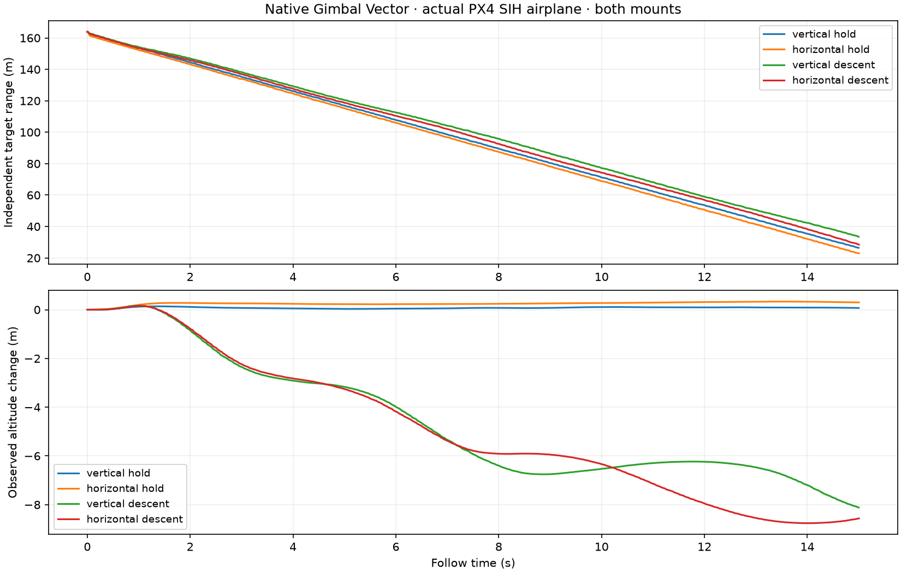
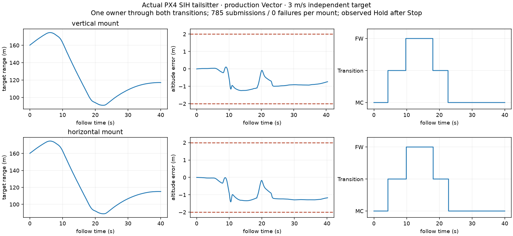
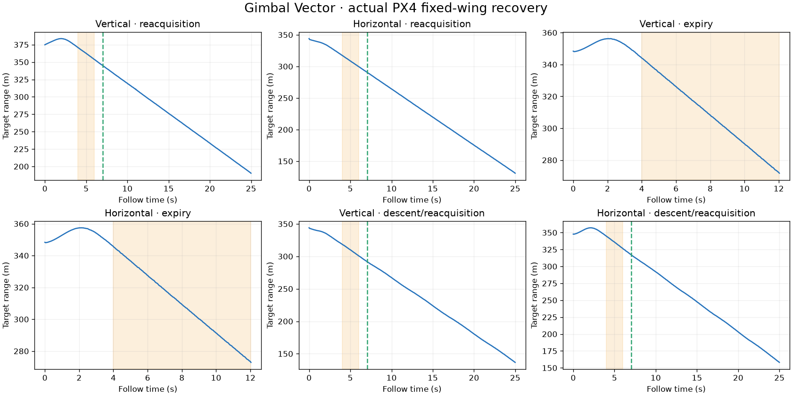
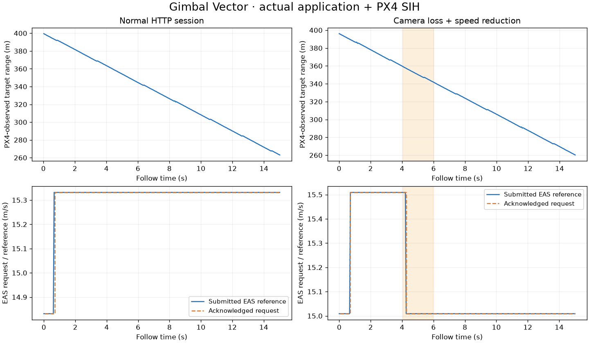

# Shared fixed-wing guidance policy

Fixed-wing guidance commands a feasible flight path and an airspeed reference.
PX4 owns coordinated turns, energy management, attitude control and allocation.
The same policy is intended for native FW objectives produced from gimbal rays
or image tracking. Input geometry remains specific to each tracker contract.

Current consolidation policy ends following on transition and requires a new
Start afterward. The [standard VTOL application checkpoint](../../reporting/agent-ops/codex-modernization/checkpoints/2026-11-13-vtol-training-app.md) records bounded Gazebo
MC/FW Start, speed, Stop and transition release. Physical-camera timing and
sensorless hardware remain separate gates. Phase-retaining cycles below are
historical evidence, not the current operator contract; see the
[consolidation plan](../05-development/follower-consolidation-plan.md).

| Setting | Factory value | Meaning |
| --- | --- | --- |
| `Follower.AIRFRAME_LAYOUT` | `AUTO` | Use fresh PX4 state; an explicit MC/FW/VTOL/tailsitter choice verifies the installation |
| `Follower.AIRFRAME_PHASE_CONFIRMATION_S` | `0.5` | Fresh settled phase dwell during Start under the original acquisition identity |
| `FixedWingGuidance.UPPER_SPEED_POLICY` | `px4_configured_max` | Respect the current native PX4 airspeed envelope |
| `FixedWingGuidance.MIN_DIVE_THROTTLE` | `null` | Keep native throttle behavior |

Schema 1.9 retires `Follower.VTOL_TRANSITION_TIMEOUT_S`. Its saved value remains
inert until explicit Config Sync preview/apply removes that leaf; it has no
replacement and cannot extend target recovery. The first fresh transition or
unexpected phase ends following; returning telemetry cannot resume it.

The Dashboard exposes these through the canonical configuration service. Apply
changes while following is inactive; they use the existing follower-restart
tier. Existing saved configurations retain their values until Config Sync
preview/apply accepts changes. Missing policy settings retain normal native
behavior. Public video/CSRT, constant-position, altitude-guidance-off,
altitude-safety and circuit-breaker defaults are preserved.

## Flight-path priority

`no_upper_speed_bound` requests experimental flight-path priority. During an
authorized target-directed descent, crossing the normal upper speed bound
alone must not redirect pitch away from the requested path. It does not request
direct nose alignment, disable underspeed protection, or remove altitude,
climb/sink, attitude and actuator constraints. It cannot guarantee deceleration
in a dive or arbitrary dive angles. Steeper target bearings remain constrained
flight-path objectives; removing an upper airspeed bound alone does not expand
the aircraft's vertical envelope.

`MIN_DIVE_THROTTLE` is an optional normalized floor during that descent: `0.10`
means 10%; `null` keeps native behavior. Native actuator bounds remain
authoritative. A throttle floor can keep motors running; it does not guarantee
control authority. It does not apply to MC flight, ordinary FW guidance or
PX4-owned transitions.

The runtime policy must share the command owner's lease and restore on Stop,
takeover, expiry, rescue or disarm. It must not rewrite saved PX4 parameters.
The policy remains unavailable unless the matching native firmware capability
has been verified; a configuration value alone cannot grant it. If the
experiment is configured but unavailable, the effective policy stays at normal
PX4 limits with native throttle and reports `unrestricted_speed_not_supported`.
This supported fallback must remain visible in diagnostics; it is not successful
activation of flight-path priority.

Temporary FW speed reductions also constrain retained recovery and blended
commands. They cannot restore an older, higher request. PX4's current native
minimum still takes precedence; an acknowledged request below a rising
load-dependent minimum is reported separately from the effective reference.

## Planned private steep-descent envelope

The operator selected this separate experimental scope on 2026-11-13. It is
**not implemented or enabled**. `no_upper_speed_bound` alone continues to retain
the normal vertical envelope described above; it must not silently acquire
steep-descent semantics.

A named private envelope will extend the descent objective only through the
same owner-bound native FW policy. It needs finite, qualified flight-path,
sink/pitch and recovery bounds consistent with the aircraft's load, rate and
actuator authority. PX4 still owns energy and attitude control. No parallel
companion controller, client-side limit resolver or global parameter rewrite is
introduced. Climb remains subject to the normal native performance envelope.
There is no arbitrary-angle or guaranteed-speed promise.

Retain load-dependent minimum-speed handling and altitude authority. The private
requested floor is now **3 m relative altitude** (2026-11-13, superseding 5 m);
the retained installation has not been changed. It is a boundary, not the point
at which pull-out begins:
the native response and stopping-height margin must constrain descent earlier.
Numerical bounds require simulated evidence and later installation acceptance;
none is selected for hardware by this planning decision.

Fast MC descent requires its own measured stopping-height check too. A temporary
speed override does not remove altitude authority, and a zero vertical request
cannot stop physical motion instantly. The existing warning band and native
response remain separate from the requested floor; neither a configured guidance
acceleration nor a command plot proves actual braking performance.

The same clarification requests no extra application altitude ceiling or
mission-specific climb/descent restriction for that private experiment. This
does not make an infeasible vertical FW path possible or remove native load,
attitude, rate, actuator and recovery constraints. Public limits stay unchanged.
Schema 1.10 supports an explicitly absent application ceiling through the
canonical `Safety.GlobalLimits.MAX_ALTITUDE: null` value and Config Sync preview,
preserving finite defaults and per-follower inheritance. The saved private
configuration is unchanged. This setting does not implement or enable the
separate native experimental vertical envelope, which remains unqualified.

Lost target evidence must command a bounded exit toward level flight while
retaining feasible course and airspeed. Reuse the existing FW recovery deadline;
retargets cannot extend it. Source degradation must resolve through the same
policy availability contract: a qualified PX4 estimate may support the envelope,
but groundspeed or a trim reference cannot establish stall margin. Unsupported
conditions downgrade the effective policy visibly; they do not manufacture
airspeed or silently claim steep-descent support.

Stop, takeover, rescue, disarm, phase change and lease expiry revoke the original
policy. Native controller restoration must avoid a released integral/reference
step without extending following authority or replaying a dive. Public defaults
remain normal; Dashboard/QGC display the backend's requested/effective envelope
and limitations without separate guidance logic. This section adds no runtime
configuration key or currently advertised capability.

## Airspeed sensor recovery

Native guidance follows PX4's selected, validated airspeed source. Restored raw
sensor packets do not establish a valid selected measurement: PX4's
[`ASPD_FS_T_START`](https://docs.px4.io/v1.17/en/advanced_config/parameter_reference#ASPD_FS_T_START)
defaults to `-1`, disabling in-flight reacceptance after a sensor failure.
PixEagle does not change that aircraft parameter or substitute groundspeed.
When PX4 supplies no qualified airspeed, the existing native sensorless behavior
and explicit `unavailable` observation remain; actual stall margin is unknown.
A request is still an EAS reference, not a measured or guaranteed aircraft speed.

## Target loss and retargeting

The effective FW continuity policy retains a feasible course and constrained
airspeed request while easing the vertical objective toward level flight. It
does not retain a dive, apply MC horizontal decay or command stationary yaw.
The factory FW time/retarget budget is eight seconds; aircraft authority,
telemetry and altitude restrictions can end recovery sooner. Repeated taps or
tracking flaps cannot renew that deadline. Invalid selections preserve the
current target. Confirmed reacquisition restores guidance smoothly; expiry
requests and confirms native FW Hold/loiter, ends the session and requires a
new explicit Start. Hold still involves forward flight.

The isolated SIH comparison retained this default-latched result, then explicitly
tested `ASPD_FS_T_START=2` as a simulator-only overlay. That case observed sensor
loss, native sensorless continuation and later qualified sensor reacceptance.
The simulator's original `-1` value was restored afterward. The comparison
documents the native policy; the recovery-enabled test setting stays out of
aircraft profiles.

## Aircraft and camera frames

| Installation / observed phase | Reused implementation |
| --- | --- |
| Pure MC | Existing MC vector math and MAVSDK owner |
| Pure FW | Native course, vertical-path and airspeed strategy |
| Settled VTOL MC or FW | Reuse the qualified phase strategy with native ownership and source readiness; current image training selects MC/FW profiles explicitly |
| Standard VTOL or tailsitter during transition | End following and release to PX4; require a fresh Start afterward; qualification remains specific to the recorded airframe/source |
| Different gimbal or mounting | Provider adapter and mounting geometry produce the same physical ray |

There is no separate tailsitter pursuit law. Public defaults provide the base
configuration; a named aircraft overlay changes only its explicit settings.
Follower-specific gains stay with that follower. Shared FW policy and PX4-owned
envelope resolution must not be copied into each aircraft or camera adapter.

The aircraft-layout choice does not establish flight phase. Actual MC/FW/
transition state comes from fresh PX4 observations. AUTO is the normal choice.
An explicit layout mismatch is an installation problem, not permission to
reinterpret telemetry.

Camera mounting remains in `GimbalTracker`. Its ray is transformed once from
physical body FRD to NED using the physical aircraft quaternion. PX4's native
FW controller supplies its own FW-frame heading and forward axis, including
the tailsitter conversion. The companion does not rotate the mounting preset
during transition or apply that conversion again.

`FixedWingVectorGuidance.calculate` retains the physical-FRD API and delegates
through one canonical quaternion rotation to `calculate_ned`. The latter requires
an explicit `ned` frame and a finite unit direction, and uses the same course,
EAS, vertical-path and altitude-envelope calculation without another rotation.
Callers must separately qualify measurement-time alignment and pursuit authority;
this shared math entry does not enable or qualify image-based FW following.

`observation_alignment.py` has one association implementation for calibrated
image bearings and typed gimbal boresight bearings. A gimbal retains its original
provider, camera source generation, geometry, angle sequence and independent
tracking-status receipt. It never acquires synthetic pixels, an image calibration
or an exposure timestamp. `AlignmentBinding` includes the provider for gimbal
input and the optical calibration for image input.

Physical association requires explicit measured `ReceiveTimeBounds`; missing
bounds remain unqualified. `observation_delay_s` bounds acquisition to receipt,
while attitude bounds include native processing and transport. Both initial and
cached-result validation check the same worst-case acquisition ages. A fresh
status poll or a newer attitude publication cannot refresh the old measurement.
An unchanged attitude sample retains its quaternion and first receipt; a reported
estimator reset invalidates the old association. Isolated SIH can explicitly use
`ExactSihSample.observation_provenance` with its retained observed attitude, but
that is component evidence, never a physical timing qualification. Public live
admission and physical installation acceptance remain closed gates.

Both native image and gimbal consumers validate the resolver result before
acquisition and again before calculation. A prepared session holds no command
authority. Native gimbal input uses the associated NED direction directly;
the MC body-ray filter must not rotate an older measurement with newer attitude.
Unchanged polls retain command age. Progressing authoritative navigation state or
an acknowledged control revision can recalculate against that original world ray.
Ordinary observation expiry invalidates nominal intent and uses the existing FW
continuity budget; it does not invoke MC emergency Stop. Geometry, aircraft
authority, native envelope and explicit Stop guards remain authoritative.

Native FW consumes an input-independent `BearingGeometryPolicy`: four validated
vertical-cone and forward/rearward thresholds. Gimbal Vector extracts those
values from its existing configuration. An image strategy can supply its own
resolved thresholds without importing gimbal capabilities, reverse translation,
stationary-yaw or grace/dwell policy. No controller or parameter resolver is
duplicated, and existing gimbal values remain unchanged.

`VectorGuidanceSession.reset_target_state()` clears native target-direction
hysteresis and turn latch without ending the session. It retains engagement
altitude, speed controls and the last feasible recovery course. A validated
retarget can use this hook; it does not reset the continuity owner's deadlines
or grant another session authority. A stopped session rejects the reset.

Start initializes one settled phase, engagement altitude, speed request and
continuity strategy. A transition ends that session and its temporary controls;
there is no phase advance, retained override or automatic resumption. A later
explicit Start requires fresh settled aircraft and target evidence and creates
a new acquisition. Old ray/filter/command history cannot seed it. With altitude
guidance off, FW holds that new session's engagement altitude. This is estimator-
referenced height, not terrain clearance; changed references invalidate it.
PX4 owns the finite transition and altitude response during release.

## Current qualification boundary

The [consolidation checkpoint](../../reporting/agent-ops/codex-modernization/checkpoints/2026-11-09-follower-consolidation.md)
is authoritative for current source, software gates and S7 admission. The figures
below retain earlier component evidence. In particular, the November 7 phase-
retaining cycles are historical and do not qualify the current end-on-transition
contract. No historical pass opens VTOL or physical installation admission.

The normal-envelope native Vector component matrix passed four 15-second
moving-target approaches on the pinned PX4 SIH airplane. Both mounts held
altitude with guidance off (maximum errors 0.138/0.333 m) and descended toward
the lower target with guidance on. All four confirmed Hold with no later
publication. The reusable local evidence browser is
`reports/sitl/native-vector-fw-matrix-20261107/index.html`; exact revisions,
traces and reproduction commands are retained beside it. This tests an approach,
not interception, landing or a physical installation.

Normal-envelope tailsitter component cycles passed for both mounts, retaining
one owner through MC/FW and back. Altitude deviations were 1.244/1.407 m within
the 2 m test gate. The SIH airframe's transition threshold was corrected from
7 to its native minimum of 10 m/s; no aircraft settings were changed. The
replay and failed comparisons are retained at
`reports/sitl/native-vector-vtol-matrix-20261107/`. This does not qualify rescue,
takeover, target loss, unrestricted policy or the complete application path.

Both mounts also passed native FW target-loss recovery with altitude guidance
off/on: continuous publication, retained course/airspeed, level request during
loss, confirmed restoration and eight-second expiry to observed Hold. A process
stall expired to Hold in 347 ms; resumed cleanup preserved subsequent pilot RTL.
The read-only replay and exact evidence are in
`reports/sitl/native-vector-recovery-20261107/`. Full application startup and
VTOL loss across phase changes remain separate gates.

The normal application/API checkpoint also passed two vertical-mount FW sessions
using local camera protocol/video fixtures and actual PX4 SIH. It verified speed
editing/replay conflicts, target loss, acknowledged recovery reductions, confirmed
Stop and no later publication. See
`reports/sitl/native-vector-application-20261107/`. This remains separate from
VTOL application faults and physical camera/aircraft qualification.

The typed policy, configuration, phase-specific controls, native frame
observations and application lifecycle binding are implemented and unit tested.
Native setup/packaging, unrestricted firmware policy and full moving-target/
VTOL acceptance remain in progress. The development adapter is not installed
by ordinary setup. Native startup requires matching firmware, a verified
aircraft, fresh observations and an explicitly configured FW recovery policy;
missing legacy recovery settings require Config Sync, not a silent authority
change. A failed preparation never falls through to MC commands on FW/VTOL.
The older `fw_attitude_rate` implementation still uses its direct-rate/thrust
contract and does **not** gain unrestricted behavior from these settings. It
must adopt the shared qualified native boundary before advertising the policy;
copying an upper-limit bypass into its local controller is not an equivalent
implementation.

Qualification reports must show independent target truth, actual PX4 position,
flight phase, flight path, requested/effective/observed speed, throttle and
constraints. Nose direction is diagnostic alongside the flight path, not the
command objective. The consolidation checkpoint separates current evidence,
retained historical runs and remaining gates.
