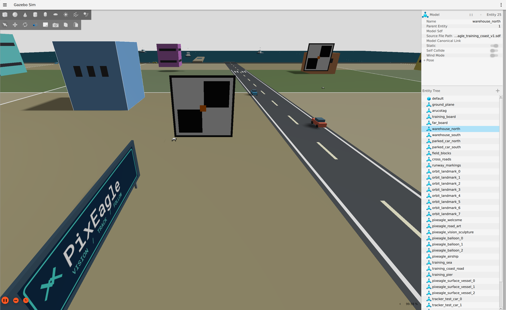
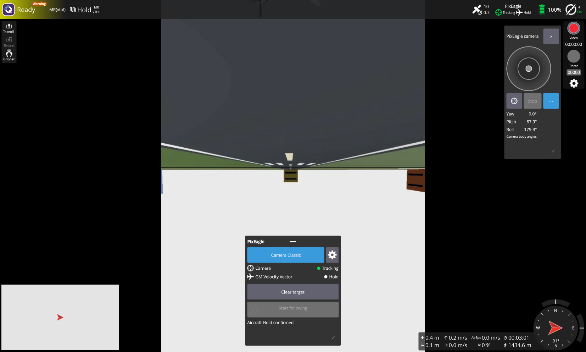
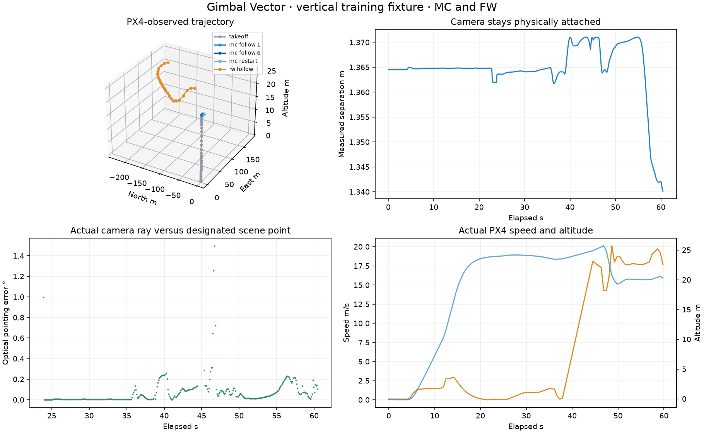

# Ubuntu simulator training

Run the normal PixEagle application, QGC and actual PX4/Gazebo in one owned,
isolated session. The beginner menu contains **multicopter, fixed-wing and standard
quadplane**. Tailsitter and external-gimbal combinations are advanced profiles,
excluded from that menu. This tool neither connects physical aircraft nor takes
off automatically.

Use a verified **stock** Gazebo build for the current MAVLink workflow. Its
manifest selects stock firmware explicitly, so FW/VTOL training does not start
the experimental DDS adapter. The earlier adapter bundle remains available only
with an explicitly selected experimental build; it is not a setup prerequisite.

The simulated guidance/workflow checkpoint was reviewed on **15 November 2026**.
[Qualification below](#what-is-actually-qualified) separates accepted workflows,
component evidence and remaining work. Camera-roll/stabilization fidelity and
hardware qualification are not passed by a working simulator.

## Start on this workstation

Open **PixEagle Simulator** on the Desktop, or run this from the prepared checkout:

```bash
python tools/launch_training.py
```

Choose a numbered entry, or `q` to leave without launching anything. The native
FW entry uses the stock conventional Cessna with an attached forward camera,
not a VTOL in FW phase. Its operator qualification remains separate from the
accepted quadplane workflow.

The menu reuses PixEagle's terminal banner. Dependency paths remain in the local
`~/.config/pixeagle/training.json`; they are not typed each time. Every run gets
a new evidence directory. Existing runs are never overwritten.

1. Sign into QGC with the disposable lab account `admin/admin`.
2. Flight commands start blocked. In this isolated simulator, permit following
   through Options when ready, then take off manually. With the public 5 m
   relative-altitude floor and 2 m warning buffer, settle above 7 m before
   Start (40 m is convenient for these training scenarios).
3. Select a visible object, Start following, adjust supported speed controls,
   then test Stop and a fresh Start. Stop must report confirmed Hold.
4. For quadplane image tracking, select MC Chase in settled MC and FW Navigation
   Chase in settled FW. Transition ends following; select/confirm a target and
   press Start again. An installed automatic MC/FW image-follower recipe is not
   implemented yet.
5. For native FW, use the normal runway Takeoff action, settle at the selected
   flight altitude, then select a visible object and use FW Navigation Chase.
   Its speed control requests an airspeed reference, not MC translation speed.
   Stock MAVLink uses attitude/thrust projection with the resolved PX4 envelope;
   it does not retain native TECS. Missing airspeed uses a labelled navigation
   speed proxy, which cannot establish actual stall margin.
6. Close QGC or press Ctrl+C in the launcher to close that token-owned stack.
   Unrelated applications and containers remain untouched.

Beginner recipes disable target-directed climb/descent. Altitude protection and
the circuit breaker stay enabled. These disposable profiles do not rewrite public
factory defaults or the private hardware configuration. Disabling altitude guidance
is not a general guarantee of altitude hold for every transport: see the
[altitude contract](follower-consolidation-plan.md#5-aircraft-controls-and-authority).



The coastal objects are static visual props. Cars, vessels and balloons do not
establish moving-target tracking, wind, buoyancy or collision qualification.

## Agent and advanced use

```bash
# Show all configured IDs, including advanced profiles; launches nothing.
python tools/launch_training.py --headless --list

# Same application and simulator, without operator windows.
python tools/launch_training.py --headless --profile tailsitter-gimbal

# Inspect exact argv without creating files or launching anything.
python tools/launch_training.py --profile tailsitter-gimbal --dry-run
```

Advanced GUI access is explicit: `--profile tailsitter-gimbal` or
`--profile tailsitter-camera`. It is not offered by the beginner menu. The
headless flag suppresses QGC, Gazebo GUI and gimbal-input windows; the actual
camera renderer still needs the prepared graphics/display runtime. It is not
yet a qualified display-free cloud/EGL setup.

The menu only assembles argv and replaces itself with
`tools/run_gazebo_training.py`. That canonical runner owns preparation,
verification, supervision, command blocking, recording and cleanup. It remains
available with explicit arguments for experts. The menu adds no controller,
aircraft classification, publisher, credential store or fallback flight path.

For automated flight qualification, use the existing authenticated actions and
owned simulator runners after an explicit test decision. Starting a headless
session alone never arms, designates a target, starts following or requests a
transition. Read-only observation/reporting must stay read-only.

## Prepare another development workstation

This is an advanced development tool, not an extra requirement for ordinary
PixEagle installation. The prepared X11 desktop renderers share the desktop IPC
namespace so Mesa can use its shared-memory image transport. Backend workers
retain private IPC, and every component retains the isolated simulator network;
no host-network, privileged-container or physical-device access is added.
Use these display-enabled containers only with trusted local development builds.
Prepare the verified builds/dependencies using the
[stock Gazebo build guide](../../../native/gazebo-build.md#stock-firmware-workflow) and QGC's build instructions.
Copy `tools/training-launcher.example.json` to
`~/.config/pixeagle/training.json`, then fill its absolute dependency paths once.
Optional search paths go in `environment`; only tool/library/module search-path
variables are accepted. No passwords belong in this file.
The example uses a stock build and needs no adapter-bundle paths. Pin the build
manifest first; changing its firmware policy changes the selected runtime and
must not be used to relabel an old binary as stock.

`arguments` contains shared canonical-runner options. Each profile contains
only its scene-specific options. Duplicate options are rejected instead of
silently overriding one another. `audience: advanced` hides an entry from the
beginner menu. `unavailable_reason` marks an incomplete launcher recipe and
prevents launching it even through headless/dry-run selection. These labels
cannot grant the backend permission to fly an unsupported profile.

For a new verified build, training binds the scene template to that build's
packaged resource hashes, records the original template and changed-resource
provenance, then runs the same complete model/world/airframe validation. Original
descriptors and historical evidence are not rewritten. Other qualification
callers retain strict historical build binding unless they explicitly request a
new template binding. A recompiled plugin or firmware is new evidence, not a
retroactive operator pass.

Useful canonical options:

| Option | Meaning |
| --- | --- |
| `--scenario` | Pinned aircraft, world, camera and resource closure |
| `--follower-mode` | Initial registered follower; does not force aircraft phase |
| `--mount-type` | Canonical external-provider raw-angle preset |
| `--frame-rotation-deg` | Existing decoder image orientation; never physical mounting |
| `--altitude-control on/off` | Explicit target-altitude guidance in the disposable profile |
| `--continuity-mode` | Existing shared recovery policy; no second loss supervisor |
| `--max-attitude-skew-s` | Declared simulator measurement/PX4 source-time bound |

The canonical qualification runner retains its historical altitude-on default;
the beginner menu explicitly supplies `off`. Advanced qualification recipes
choose their altitude behavior explicitly. The shared pairing bound defaults
to 100 ms after measured 4–76 ms source lead exceeded the former 50 ms bound.
Original timestamps and actual skew remain in evidence. Do not raise a timing
bound merely to turn a failed qualification green.

## Inputs, frames and replacement cameras

| Boundary | Single owner / reference |
| --- | --- |
| Fixed 2D camera | Source-bound intrinsics, physical optical-to-body calibration and image timing; [mounting guide](../../trackers/06-integration/camera-mounting.md) |
| External tracker | Original angles and independent lock status through one provider/runtime; [provider guide](../../trackers/05-development/external-gimbal-providers.md) |
| Raw axis/sign/zero conversion | Canonical `gimbal_geometry.py`; no per-client or per-follower mount patches |
| Aircraft phase and physical quaternion | Fresh connection-owned PX4 observations; native FW heading is separate |
| Simulator camera mechanics | Pinned SDF links/joints, native joint controllers and measured link feedback |
| Display click/rectangle | Existing inverse orientation mapping, exact displayed-frame provenance and guarded action |

Do not swap physical mounts during transition or apply PX4's tailsitter FW
rotation twice. The fixed-nose tailsitter sees sky in MC and the horizon in FW;
a display rotation cannot repair a camera facing the wrong direction. A source
or calibration change invalidates its existing context. Multiple-camera
switching remains separate work.

The external-gimbal fixture receives ordinary 2D video plus angles/status.
Private simulator depth keeps a clicked scene point centered; it is never a
real tracker range/pose requirement. Both point and rectangle selection use
the original displayed frame. One `gm_velocity_vector` chooses its MC/FW strategy
at a fresh Start from observed state; transition ends that session.

The current fixture is physically attached, but its 0.04 kg payload, 90°/s ideal
actuation and ±180° training pitch range are **not measured FL-30 mechanics**.
Image-roll stabilization is not modeled faithfully. The retained operator view
below illustrates that open visual limitation after Stop, not a fully qualified
camera replica. See the [simulator contract](../../gimbal_simulator.md#rendered-gimbal-training).



A future provider should implement its protocol/lifecycle and declare its
measurement frame/capabilities, then validate measured forward/right/down rays,
both supported mounts, freshness, selection, Stop and reconnect. Reuse the shared
geometry, actions, session controls and publisher. Do not copy a follower or add
vendor checks to Dashboard/QGC. Manual sliders are simulated inputs, not proof
of a physical optical tracker. A mouse-coordinate stimulus cannot seed a real
tracker simply by replacing an App getter; that general input mode remains
unqualified.

## What is actually qualified

These are bounded workflow observations at their recorded revisions, not a
claim that every follower, aircraft, sensor or new revision is fully qualified.

| Airframe and input | Scope of retained result |
| --- | --- |
| Native MC + rendered 2D / CSRT | MC Chase pursuit and speed accepted by operator; earlier Start/Stop/UI failures and shared repairs remain recorded |
| Native FW + image or external input | Operator approved standalone Cessna/camera pursuit; startup status interruptions required the separate recovery repair |
| Standard quadplane + rendered 2D / CSRT | Operator accepted MC Chase and FW Navigation Chase, speed changes, Stop/Hold and restart workflow |
| Tailsitter + fixed nose / CSRT | FW pursuit accepted; original Stop failed. Shared Stop repair was renewed on gimbal runs; final fixed-nose Stop/restart regression remains distinct |
| Tailsitter + simulated external gimbal | Operator accepted MC/FW guidance/workflow; 669/669 publication attempts succeeded, no native error replies, final operator Stop confirmed Hold |
| Native MC + external gimbal, both mounts | Component evidence exists; current standalone full-GUI/hardware requalification is separate |

Other followers retain their individual [SIH qualification inventory](follower-sih-validation-matrix.md).
The menu does not convert component results into operator or field acceptance.
The quadplane [acceptance checkpoint](../../reporting/agent-ops/codex-modernization/checkpoints/2026-11-14-quadplane-acceptance-tailsitter.md)
and [current recap](../../reporting/agent-ops/codex-modernization/checkpoints/2026-11-15-training-workflow-recap.md)
identify source versions and raw evidence directories.



Remaining release gates: standalone FW GUI workflow; fixed-nose final Stop
regression; simulator roll/mechanical fidelity; the separately failed native FW
altitude-hold tolerance; physical camera protocol/axis/timing checks; target
hardware packaging and platform artifacts. No public release or hardware-flight
approval follows automatically from this checkpoint. The customized QGC remains
unpublished and has no public PR.

Video delivery and target evidence have separate lifetimes. GCS packet loss or
a closed video receiver does not end healthy onboard tracking. Camera-dependent
tracking without fresh input uses the existing bounded recovery; independent
gimbal observations can continue when their own measurements remain valid.
A stale displayed frame cannot authorize a new selection. Aircraft-state loss,
pilot takeover and Stop keep precedence. See the
[startup recovery checkpoint](../../reporting/agent-ops/codex-modernization/checkpoints/2026-11-15-native-fw-startup-recovery.md).
