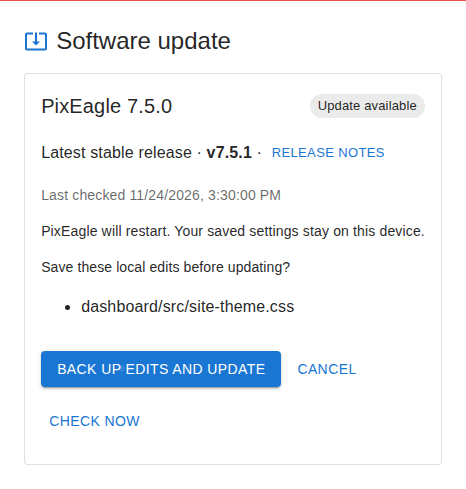

# Update PixEagle from the Dashboard

Open **About → Software update**. The page shows the installed version, the latest official stable release, its release notes and the time of the last successful check. Opening the page checks at most once a day after a successful lookup. **Check now** refreshes it. Checking leaves the installation running.

*Example review on a checkout with one edited source file. The versions in the screenshot are illustrative.*

1. When the device is idle, choose **Update to …**. On a clean installation this starts the update.
2. If the page lists local code edits, review the filenames. **Back up edits and update** saves them in a named Git stash. **Cancel** leaves the checkout alone. PixEagle keeps its active YAML, credentials and local configuration exports on the device.
3. If the new release requires a saved value to change, review its previous and proposed values and approve them to continue. You can instead edit Settings and check again. A validation failure at this stage leaves the existing runtime running.
4. Keep the device powered during the restart. The page reconnects and shows the result. You can reopen the same page after a disconnect or from another browser. **Update complete** means the backend reported the expected revision, version and effective settings and served the expected Dashboard. Open **Review settings changes** if the release has optional new defaults or retirements.

## When the Update button is unavailable

| What you see | What to do |
| --- | --- |
| Up to date, ahead, or a different local revision | Keep the installed version. The Dashboard installs newer stable releases on a fast-forward history. |
| Could not check GitHub | Check internet access from the PixEagle device. The date identifies the last successful check. |
| Installation profile missing | On an older installation, use the normal host update workflow once and select its existing Core or Full profile. The initializer records it for later updates. |
| Device busy or restart unavailable | Finish the active operation, then check again. Sign in as an administrator from an origin permitted by the installation’s existing restart policy. |
| Service permission or worker unavailable | Use the host updater. The Dashboard uses the standard Linux manual launcher or managed systemd service, an independent systemd worker, and the installation owner’s existing permissions. |
| Private changes conflict with the incoming release | Move or reconcile the named local files on the device, then review the update again. |

The Debian/Ubuntu/Raspberry Pi installation must have a Git checkout, a working environment, the standard Dashboard and sufficient space for the release and its dependencies. A 512 MiB preflight check catches very low space. The actual requirement depends on the installation profile. The first installation of a release containing this feature still uses the [host installation workflow](../INSTALLATION.md).

## Recovery and local code edits

**Previous version restored** means the earlier source and runtime passed the restart checks. **Recovery required** means the worker could not confirm recovery. After a power interruption or a failed recovery, keep the device idle and inspect the maintenance record on the host. Job logs and the pre-update settings copies are private to the installation owner under `.pixeagle_runtime/updates/<job-id>/`. The `current.json` file identifies the last job. Keep these files private because the settings copies can contain credentials.

Use `git status` and `git stash list` in the installation checkout. The page reports the saved stash ID. Inspect it with `git stash show --stat --include-untracked <stash-id>`. Reapply reviewed code edits in a developer checkout with `git stash apply --index <stash-id>`. An update never replays local code edits automatically.

If host repair is needed, follow the [stopped-runtime repair procedure](../SERVICE_MANAGEMENT.md). Verify the intended source revision, settings, backend and Dashboard before resuming operation. After a manual recovery, archive the private `current.json` pointer outside the updates directory while the runtime is stopped to clear a **Recovery required** record. Keep the original job directory for diagnosis.

For an unattended service update, the installation owner must be able to run the maintenance commands through sudo without a prompt. The installer and Dashboard share this check, including Raspberry Pi OS installations with mixed password and passwordless sudo rules.
