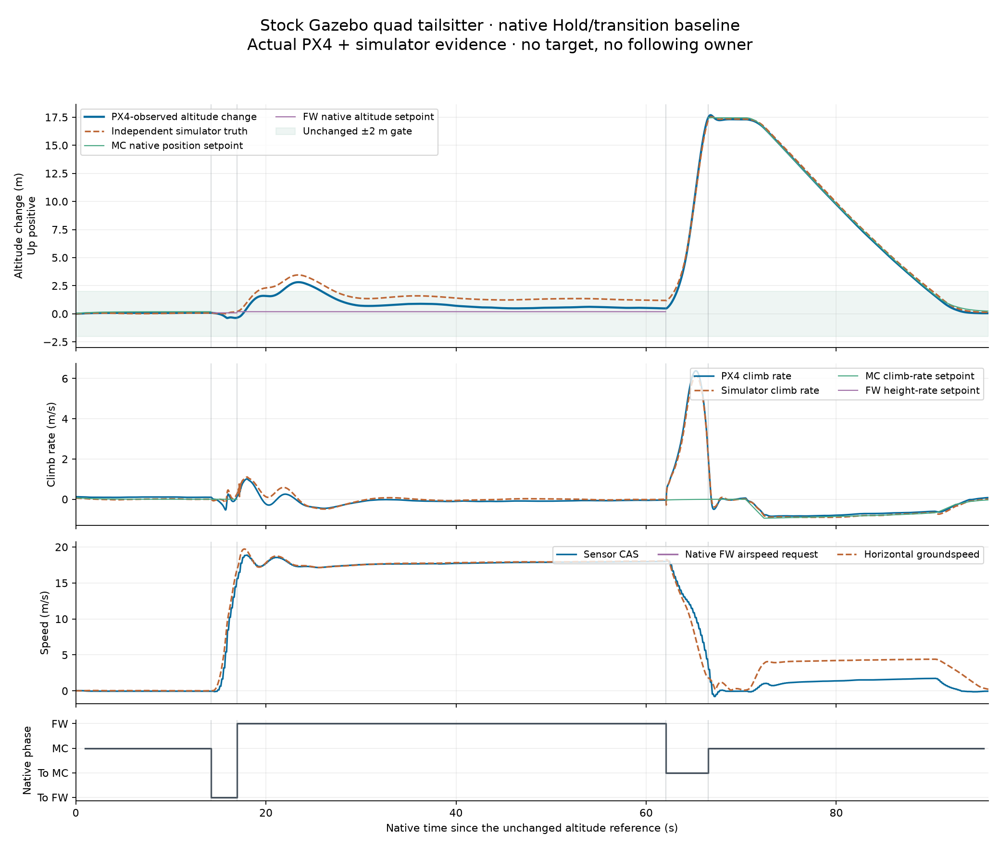

# Native-only transition baseline

The operator separated native transition performance from follower
qualification on 2026-11-13. This tool retains its original full-window 2 m
diagnostic and failed captures. Those results describe the airframe maneuver;
they do not establish a PixEagle pursuit failure or block separate following
tests. Following must still end at transition entry. Test its authority release,
publication through release, and absence of obsolete commands independently.
A fresh Start requires a settled phase. No native-motion subtraction or verdict
promotion is permitted.

`tools/run_native_transition_baseline.py` is an opt-in **simulator control tool**,
separate from the read-only visualizer/probe. It prepares native MC Hold,
requests one pilot front transition, observes FW Hold, requests one guarded
back transition and observes MC Hold. It never acquires following, sends an
intent or creates a target publisher. No hardware, device mount, published port
or arbitrary caller-selected airframe is supported.

By default it only prints a plan, without Docker, clients, output directories
or control actions:

```bash
PYTHONPATH=src python tools/run_native_transition_baseline.py \
  --scenario tools/native_baseline_scenarios/gazebo-quadtailsitter-hold-cycle.json
```

Actual execution requires explicit `--execute`, a strictly verified
`--simulation-build-manifest`, a new `--output`, and the existing pinned
`--adapter-bundle` plus `--adapter-file-manifest`. For a reviewed control
firmware authority, `--build-repository` forwards the same explicit source
authority used by the shared validator. Existing artifacts are never repaired
or overwritten. A future reviewed invocation has this shape:

```bash
PYTHONPATH=src python tools/run_native_transition_baseline.py --execute \
  --scenario tools/native_baseline_scenarios/gazebo-quadtailsitter-hold-cycle.json \
  --simulation-build-manifest /reviewed/build/gazebo-build-manifest.json \
  --adapter-bundle /reviewed/runtime-bundle \
  --adapter-file-manifest /reviewed/runtime-files.json \
  --output reports/sitl/new-native-only-baseline
```

The shared launch helper owns the source-built primary image/model/world,
private UID/rootfs and network isolation. The fixed observer image runs the
adapter and DDS Agent in a second token-owned container sharing only the
primary network namespace and private runtime directory. Its mount is
`/runtime`, preserving the observer image's `/work/ws` ROS workspace. There is
no ABI assumption between the two images. Both original CIDs must remain
running and verified before simulated arm/takeoff. The sidecar first runs only
the fixed DDS Agent as its foreground process. The host polls the original
private primary's fixed read-only `px4-uxrce_dds_client --instance 0 status`
command: exact connected status, converged time synchronization and UDP Agent
`127.0.0.1:8888` are required. The pinned native source sets connected only after
session synchronization, entity creation and data requests succeed; exit zero
or the substring `connected` alone is insufficient.

One detached exec then starts the ordinary adapter in that same sidecar. DDS
readiness, this single launch and socket arrival share the original 45-second
startup admission budget, checked around bounded probes and ownership
inspections. It is not a hard cancellation deadline for every Docker inspect.
The adapter's normal ten-second discovery budget is unchanged. A lost launch
reply cannot trigger another adapter launch. Raw DDS status and launch evidence
are retained; full firmware verification and the native handshake still follow
socket arrival. Fresh native observations
and native vehicle-status timestamps qualify each action within one existing
30-second preflight budget. Ordinary startup unavailability may wait; positive
owner, identity or rescue failures do not become retries.

Scenario data selects only the known SIH VTOL models or the manifest-derived
stock Gazebo quadtailsitter, MIS takeoff altitude and explicit native transition
timing/CAS fixture values. Native source bounds are checked. Pinned rcS applies
literal `PX4_PARAM_*` overrides after airframe defaults and before simulator,
commander and Navigator startup. Only a fresh empty parameter store is used;
readback precedes flight actions. No mid-run MIS write/cache barrier is copied
forward. `SDLOG_PROFILE=131` and the accepted additive nineteen-topic file are
fixed; gain, trim and transition failure-timeout overrides are not supported.

The explicit `gazebo-quadtailsitter-slow-back-cycle.json` diagnostic changes
only `VT_B_TRANS_DUR` from the stock airframe's 5 s to 10 s, retaining the 30 m
takeoff and both 8 s triggers / 48 s captures. The pinned native parameter
bounds (0.1–20 s), startup overlay and pre-arm readback apply unchanged.
Tailsitter code uses this duration for pitch rate and maximum back-transition
time; doubling it halves the prescribed pitch rate from 18 to 9 degrees/s.
This single contrast tests maneuver sensitivity. It is not a default or private
configuration change, a tuning sweep, or evidence of passing the unchanged
2 m gate. The retained stock and matched patch0003 captures remain failed;
front-transition performance remains a separate failure. Use the same reviewed
stock measured-model image when comparing this fixture.

The production native client sends only hello/bind/observe. The existing stable
predicate still needs seven progressing samples, the same freshness and native
envelope checks. A target phase cannot borrow the prior phase's window. Rescue,
unknown phase, stale data or native Hold exit prevents inverse admission.
Earlier altitude performance failure alone may still permit a healthy inverse
diagnostic, but the result stays failed: the fixed 2 m reference is never reset.
All numeric raw poses, including unusable replies, contribute to the excursion
metric. Closed ULog estimator and actual ground-truth topics independently
cover the full native-clock window without filtering out pose flags or inventing
a host/native clock conversion. Missing truth/coverage, dropouts or corruption
cannot produce a pass. No active external 100 ms publication gate is exercised.

Cleanup closes the observer, attempts one original-primary logger flush and
stops both original token-owned CIDs even after probe/close/flush failure. It
adds no mode action. Commands, original observations, build/isolation/binding
proofs, native clock markers, closed logs and verdicts remain in the output.
Legacy report helpers/raw failures remain unchanged; extraction provenance and
runtime pins are in `native/baseline-runtime.json` without report-path imports.

Reproduce the software checks without any simulator:

```bash
PYTHONPATH=src pytest tests/test_native_transition_baseline.py \
  tests/test_gazebo_native_verifier.py tests/unit/test_sih_baseline.py \
  -m "not sitl and not px4 and not e2e and not hardware and not manual" --strict-config
```

The existing `.github/workflows/tests.yml` coverage step selects `tests/` with
the same external-runtime exclusions, so this unmarked mock-test file is
already included. `requirements.txt` includes the development ULog dependency;
no extra workflow or service is added. Software checks do not establish a
successful SIH/Gazebo flight. This canonical runner remains **response
unqualified**. Its first Gazebo attempt failed before arm because observer
discovery started before PX4/DDS session readiness. That closed R1 evidence is
retained; a separately reviewed R2 capture verifies the sequencing repair below.
These software checks do not qualify sensorless flight, a private airframe,
pursuit or hardware.

## Observed stock quad response

The 2026-11-13 stock `4018_gz_quadtailsitter` capture passes startup, native
preflight and initial MC hover. Both pilot transitions execute without a pursuit
owner or external setpoints. **Altitude response fails the unchanged 2 m gate:**
forward observations reach 2.817 m upward excursion; the full closed log reaches
17.684 m in estimated pose and 17.534 m in independent simulator truth. The final
seven MC samples also fail the existing hover-stability requirement.



The native scheduled back-transition pitch-up converts forward speed into
height: ground truth rises 16.344 m from transition entry, near its 16.618 m
kinetic-height equivalent. The near-zero vertical request does not command this
climb. This supports a native maneuver/plant explanation; it does not prove a
2 m envelope impossible. A matched comparison with and without patch0003 now
retains about 17.06 m and 17.21 m of full-window truth excursion, respectively.
The climb persists without that patch; this is not proof of equivalence across
the full trajectories. A single 10 s back-transition contrast still fails at
14.44 m. No tuning is adopted. Further native maneuver tuning is outside this
following/recovery checkpoint.

This is the stock 1.635 kg composite Gazebo model with its airspeed sensor,
firmware parent `155f415168cef08dca2f5d85d2bc258b44a589ec` plus patches0001–0007,
and binary SHA `ff4369a61964f5a192e6a47d4fe6d69ddcf84158989cc503275af1883b95b142`.
It is not the private airframe. The 43,450,776-byte ULog has no dropouts,
corruption or pose reset within the 44.508–140.520 s native window; its SHA is
`430badca4cdc2b4a5ea628fbd7e73db79e51c7c5562533566a9b1a05a1b23004`.
The retained run is `reports/sitl/follower-consolidation-20261111/s7-gazebo-native-hold-cycle-r2`.
The linked local evidence review provides the full plot, CSV and separate source
and physical-response audits. Mandatory verification delays the actual pilot
commands about six seconds after their scheduled trigger; native phase events
anchor this figure. The continuous log covers those observation gaps. No active
external publication-cadence gate is exercised. Both original containers stop;
the Agent's exit137 is recorded as forced teardown, not a graceful shutdown.
